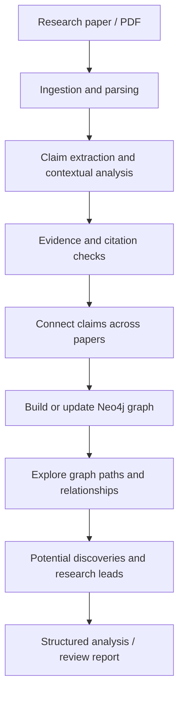
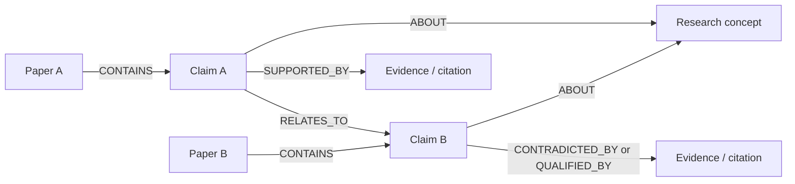

# Causalith — Research Paper Analysis & Discovery Graph

> An AI-powered research analysis platform that extracts claims from academic papers, examines their supporting evidence, and connects related findings in a Neo4j knowledge graph to help surface potential research connections and new directions.

**Live website:** [causalith.com](https://www.causalith.com/)

<!-- Replace these paths with screenshots from the live application. Add image files to docs/images/. -->
<p align="center">
  
</p>

<p align="center">
  <em>Research interface preview — replace this placeholder with a real application screenshot.</em>
</p>

## Overview

Research papers are difficult to compare at scale: important claims are spread across sections, evidence is described in different ways, and relationships between papers can be hard to see. Causalith is designed to turn paper-level reading into a connected view of the literature.

The workflow focuses on **claims, evidence, relationships, and discovery**:

1. Ingest a research paper and identify its important claims.
2. Analyse claims in context and connect them with relevant papers or evidence.
3. Represent papers, claims, and their relationships as nodes and edges in a Neo4j graph.
4. Explore connected findings to identify supporting, overlapping, conflicting, or potentially novel relationships.
5. Present the analysis in a structured, graph-oriented view to support further investigation.

> **Important:** A graph connection is a lead for investigation, not proof that a scientific discovery is new or correct. Novelty and scientific validity require checking the original sources and relevant literature.

## Key capabilities

- **Claim-focused paper analysis** — break papers into meaningful claims rather than treating each paper as a single document.
- **Evidence and citation checking** — use available scholarly metadata and source context to help assess claims and references.
- **Cross-paper connections** — relate claims that discuss similar concepts, methods, findings, or research questions.
- **Knowledge graph with Neo4j** — model papers, claims, concepts, and their relationships as graph nodes and edges.
- **Discovery-oriented exploration** — use graph paths and connected claims to spot patterns, research gaps, possible contradictions, and hypotheses worth checking.
- **Structured review workflow** — organise analysis into distinct stages such as ingestion, review, fact-checking, scoring, aggregation, formatting, and report generation.

## How it works



The exact stages and integrations depend on the configured application and available sources.

## Exploring discoveries through a graph

A paper is not just a document node. Its claims can be represented individually and connected to concepts, evidence, and other claims.

Example conceptual graph:



Possible relationship types include `CONTAINS`, `SUPPORTS`, `CONTRADICTS`, `RELATES_TO`, `CITES`, and `ABOUT`. Treat these as an illustrative schema: use only relationship types actually implemented by the application.

By following graph paths across multiple papers, a researcher can investigate questions such as:

- Which claims support or qualify a particular finding?
- Do different papers reach similar conclusions using different methods?
- Are there claims that appear to conflict, and what evidence explains the difference?
- Which concepts connect otherwise separate research areas?
- What untested relationship could motivate a follow-up experiment?

The system should present these as **candidate connections or hypotheses**, with traceable source references, rather than asserting novelty without verification.

<p align="center">
  
</p>

<p align="center">
  <em>Knowledge graph screenshot placeholder — replace with a real graph visualization.</em>
</p>

## Technology stack

Based on the project's documented stack and current project structure:

- **Python** — analysis and workflow logic
- **LangGraph / LangChain** — orchestration of multi-stage or agent-based analysis
- **FastAPI** — backend API
- **Groq LLM** — language-model inference
- **arXiv API / Google Scholar** — scholarly discovery and citation metadata, where configured
- **Vector database** — semantic similarity and retrieval, depending on the configured backend
- **Neo4j** — graph representation of claims, papers, concepts, and relationships
- **HTML, CSS, JavaScript** — web interface

Confirm each dependency against the current code and environment before treating this list as an exact deployment specification.

## Repository structure

```text
automated peer review/
├── backend/
│   ├── main.py                 # FastAPI application entry point
│   ├── graph.py                # Workflow / graph orchestration
│   ├── requirements.txt        # Python dependencies
│   ├── nodes/
│   │   ├── ingestion.py        # Paper ingestion
│   │   ├── reviewer.py         # Academic review
│   │   ├── fact_checker.py     # Claim / citation checks
│   │   ├── scoring.py          # Review scoring
│   │   ├── aggregator.py       # Combine node results
│   │   ├── formatter.py        # Format structured output
│   │   └── report.py           # Report generation
│   └── README.MD
├── frontend/
│   └── index.html              # Frontend entry point
├── docs/
│   └── images/                 # Add application screenshots here
└── .gitignore
```

## Run locally

These are the general steps for the checked-in Python/HTML project. Adjust commands if the backend README specifies a different startup command or required services.

### 1. Clone the repository

```bash
git clone https://github.com/anuragthakur107/repo-analyzer-git_inspect-.git
cd "automated peer review"
```

If you cloned into a different directory name, `cd` into that directory instead.

### 2. Create and activate a virtual environment

**Windows PowerShell**

```powershell
python -m venv .venv
.\.venv\Scripts\Activate.ps1
```

### 3. Install backend dependencies

```powershell
pip install -r backend/requirements.txt
```

### 4. Configure environment variables

Create `backend/.env` locally and add the credentials and service settings required by your implementation (for example, an LLM API key or scholarly API settings).

- Never commit `.env` or API keys.
- Keep `.env.example` limited to variable names and safe placeholders.
- Configure Neo4j and the vector store only if the current application requires them.

### 5. Start the backend

From the repository root, a typical FastAPI command is:

```powershell
uvicorn main:app --app-dir backend --reload
```

If the application object or startup instructions differ, use the command documented in `backend/README.MD`.

### 6. Open the frontend

Open `frontend/index.html` in a browser, or serve it using the frontend workflow configured by the project. If the page calls the backend, make sure its API base URL matches the local server and that CORS is configured appropriately.

## Screenshots

Add real screenshots to `docs/images/` and update the paths below. Recommended screenshots:

| Screenshot | Suggested filename | What it should show |
|---|---|---|
| Main interface | `dashboard.png` | The main paper-analysis experience |
| Claim analysis | `claim-analysis.png` | Extracted claims with evidence or source references |
| Knowledge graph | `knowledge-graph.png` | Paper and claim nodes connected in Neo4j |
| Review report | `review-report.png` | Structured findings, checks, and review summary |

To add images, create `docs/images/` in the repository and place the screenshot files there. Then commit and push them with Git.

## Responsible interpretation

- Generated analysis can be incomplete or incorrect; verify important statements against original papers.
- Similarity between claims does not automatically mean one supports or contradicts the other.
- Do not label a connection a “new discovery” until prior work and supporting evidence have been checked.
- Preserve paper identifiers, citations, and relevant excerpts so findings can be traced back to their sources.
- Do not upload private manuscripts, copyrighted datasets, API keys, or confidential documents without permission.

## Current status

This repository contains the backend workflow modules and a lightweight frontend. The live website is linked above. Update this section with the exact features currently deployed, known limitations, and setup instructions verified against your environment.

## Contributing

Contributions and suggestions are welcome. For a change, open an issue describing the problem or proposed improvement, then submit a pull request with a concise explanation and relevant tests.

## License

No license is specified here. Add a `LICENSE` file before granting others explicit permission to reuse, modify, or distribute this code.
