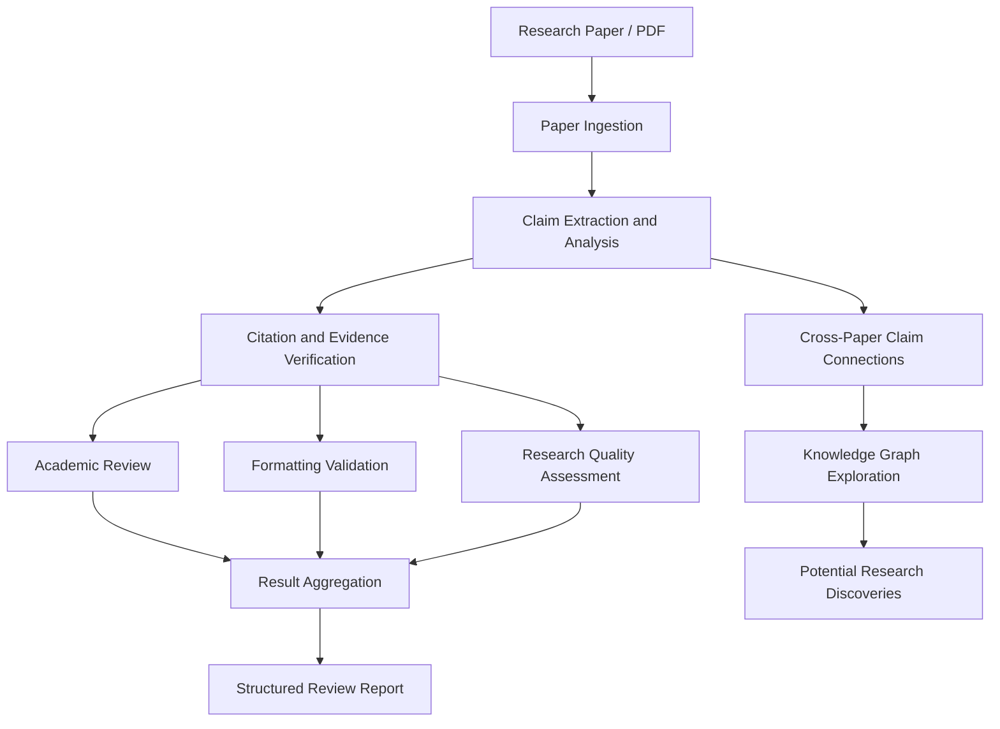
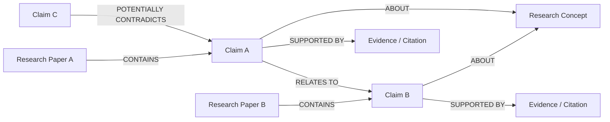

# Automated Peer Review System — Research Analysis & Discovery Graph

An AI-powered research paper analysis system that automates academic review, evaluates research claims, verifies citations, and explores relationships between findings using graph-based knowledge representation.

## Overview

Research papers contain valuable claims, evidence, and insights, but discovering connections across multiple papers can be challenging. This project combines multi-agent AI workflows and graph-based knowledge representation to support systematic research analysis.

The system analyses research papers, evaluates claims, checks citations and formatting, and generates structured review reports. Its discovery-oriented approach focuses on connecting related claims across papers to identify potential research directions, supporting evidence, and possible contradictions.

## Key Features

- **Automated Peer Review:** Evaluates research papers using specialized AI review components.
- **Research Claim Analysis:** Analyses claims in context and considers their relevance.
- **Citation Verification:** Cross-checks references against scholarly sources such as arXiv and Google Scholar, where configured.
- **Formatting Compliance:** Checks paper formatting against configured academic standards.
- **Multi-Agent Workflow:** Uses LangGraph to coordinate separate review components.
- **Parallel Processing:** Executes independent review tasks concurrently.
- **Knowledge Graph Exploration:** Represents papers, claims, concepts, and relationships as graph nodes and edges where Neo4j is configured.
- **Potential Discovery Identification:** Helps explore connections, conflicting claims, research gaps, and hypotheses that deserve further investigation.
- **Structured Reports:** Combines analysis results into an organised review report.

## System Pipeline



## Research Discovery Through Knowledge Graphs

The objective is to move beyond reviewing papers individually and help researchers explore relationships across the literature.

A conceptual graph can represent:

- **Paper nodes:** Research papers and their metadata.
- **Claim nodes:** Findings, hypotheses, and statements extracted from papers.
- **Concept nodes:** Topics, methods, and scientific concepts.
- **Evidence relationships:** Links between claims and their supporting sources.
- **Cross-paper relationships:** Connections between similar, supporting, or potentially conflicting claims.

### Claims–Paper Relationship Graph



By exploring connections between claims, researchers can investigate:

- Whether different papers support similar conclusions.
- Which findings appear to conflict or require verification.
- How ideas and methods connect across research areas.
- Which relationships may suggest new research questions or experiments.

These connections are starting points for investigation, not proof of scientific validity or novelty. The graph above is conceptual; actual node types and relationships should match the implemented application.

## Technology Stack

- **Language:** Python
- **AI Workflow Orchestration:** LangGraph, LangChain
- **Backend:** FastAPI
- **LLM:** Groq API
- **Research Sources:** arXiv API and Google Scholar integration, where configured
- **Knowledge Graph:** Neo4j, where configured
- **Semantic Retrieval:** Vector database, depending on configuration
- **Frontend:** HTML, CSS, JavaScript

## Project Structure

```text
automated peer review/
├── backend/
│   ├── main.py
│   ├── graph.py
│   ├── requirements.txt
│   ├── README.MD
│   └── nodes/
│       ├── ingestion.py
│       ├── reviewer.py
│       ├── fact_checker.py
│       ├── scoring.py
│       ├── aggregator.py
│       ├── formatter.py
│       └── report.py
├── frontend/
│   └── index.html
├── docs/
│   └── images/
└── .gitignore
```

## Getting Started

### 1. Clone the Repository

```bash
git clone https://github.com/anuragthakur107/research_paper_analysis-automated_peer_review-.git
cd research_paper_analysis-automated_peer_review-
```

### 2. Create a Virtual Environment

On Windows PowerShell:

```powershell
python -m venv .venv
.\.venv\Scripts\Activate.ps1
```

### 3. Install Dependencies

```powershell
pip install -r backend/requirements.txt
```

### 4. Configure Environment Variables

Create a `backend/.env` file with the API credentials and settings required by the application.

- Never commit API keys, passwords, or private credentials to GitHub.
- Keep `.env.example` limited to variable names and safe placeholders.
- Configure Neo4j and any vector database if the application requires them.

### 5. Start the Backend

From the project root, try:

```powershell
uvicorn main:app --app-dir backend --reload
```

If the FastAPI application uses a different entry point or startup command, follow `backend/README.MD`.

### 6. Open the Frontend

Open `frontend/index.html` in your browser. If it communicates with the backend, ensure the API URL and backend CORS settings are configured correctly.

## Screenshots

Add screenshots to `docs/images/` to demonstrate the application.

| Screenshot | Filename | Description |
|---|---|---|
| Main interface | `dashboard.png` | Main application interface |
| Claim analysis | `claim-analysis.png` | Research claim analysis |
| Knowledge graph | `knowledge-graph.png` | Papers, claims, and relationships |
| Review report | `review-report.png` | Generated review report |

Embed screenshots using Markdown:

```markdown


```

## Responsible Use

- Verify important findings against original research papers.
- Treat AI-generated claims and relationships as suggestions requiring validation.
- Preserve source references so claims can be traced back to the literature.
- Do not describe a finding as a novel discovery without checking relevant prior work.
- Keep API keys, private documents, and confidential research data out of the public repository.

## Future Improvements

- Interactive exploration of the research knowledge graph.
- Improved claim-to-evidence traceability.
- More detailed cross-paper relationship analysis.
- Research gap identification and hypothesis generation.
- Enhanced evaluation of citation verification and review quality.

## License

No license has been specified. Add a `LICENSE` file if you intend to grant others permission to reuse, modify, or distribute this project.